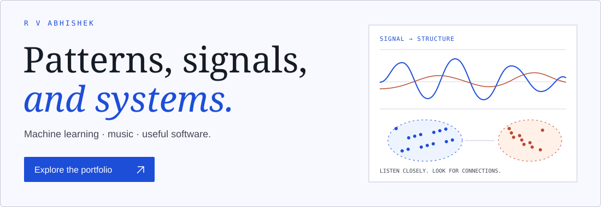

<a href="https://r-v-abhishek.github.io/Portfolio-Website/">
  <picture>
    <source media="(prefers-color-scheme: dark)" srcset="assets/portfolio-dark.svg" />
    <source media="(prefers-color-scheme: light)" srcset="assets/portfolio-light.svg" />
    
  </picture>
</a>

# Hi, I’m Abhishek.

I build where **machine learning meets useful software** — computer vision, language, agentic applications, and the systems around them. I’m a **Data Science Intern at Amagi** and a Computer Science & Data Science student at **BMSCE**, based in Bengaluru.

**[Explore my portfolio ↗](https://r-v-abhishek.github.io/Portfolio-Website/)** · [Work](https://r-v-abhishek.github.io/Portfolio-Website/projects/) · [Experience](https://r-v-abhishek.github.io/Portfolio-Website/experience/amagi/) · [About](https://r-v-abhishek.github.io/Portfolio-Website/about/) · [Contact](https://r-v-abhishek.github.io/Portfolio-Website/contact/)

## A few things I’ve built

| Project                                                                                          | What it explores                                                                                |
| :----------------------------------------------------------------------------------------------- | :---------------------------------------------------------------------------------------------- |
| [Expense Logger](https://github.com/R-V-Abhishek/Expense-Logger)                                 | Conversational expense tracking with LangGraph routing, thread memory, and a persistent ledger. |
| [Network Intrusion Detection](https://github.com/R-V-Abhishek/network-intrusion-detection-nosql) | Two-stage classification connected to a streaming pipeline and dashboard.                       |
| [ArtFolio](https://github.com/R-V-Abhishek/ArtFolio)                                             | A Flutter/Firebase Android app for creative portfolios and community.                           |
| [CA Study Companion](https://github.com/R-V-Abhishek/CA_Study_Guide)                             | Syllabus coverage, revision, and historical exam intelligence; in development.                  |
| [SaffronSpice](https://github.com/R-V-Abhishek/SaffronSpice)                                     | A full-stack restaurant application for menus, reservations, and ordering.                      |

[More work & explorations →](https://r-v-abhishek.github.io/Portfolio-Website/projects/)

## The toolkit, in context

Python · SQL · Pandas · NumPy · Scikit-learn · YOLOv8 · Librosa · LangGraph · Streamlit · React · Node.js · PostgreSQL · Spark · Kafka · Docker · FFmpeg

[Skills & foundations →](https://r-v-abhishek.github.io/Portfolio-Website/skills/) · [Writing & notes →](https://r-v-abhishek.github.io/Portfolio-Website/blog/)

## Beyond the code

I’m a **Carnatic vocalist**, with **75+ concerts** across Karnataka and Tamil Nadu, and a self-taught percussionist. **SwaraSync**, my Carnatic music practice assistant, connects pitch tracking with a handcrafted raga grammar and finite-state validation. It was a **Top 6 National Finalist** at the Unisys Innovation Program.

[The music behind the work →](https://r-v-abhishek.github.io/Portfolio-Website/about/#music)

---

[LinkedIn](https://www.linkedin.com/in/r-v-abhishek) · [rvabhi2504@gmail.com](mailto:rvabhi2504@gmail.com) · [Resume ↓](https://r-v-abhishek.github.io/Portfolio-Website/resume.pdf)
